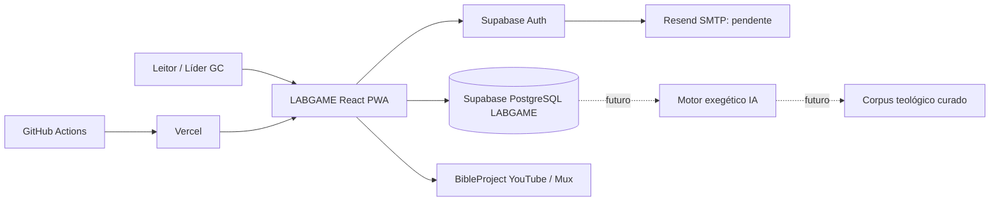

# LABGAME — Arquitetura de Referência

**Versão:** 1.0 · **Data:** 2026-10-12 · **Status:** arquitetura efetivamente implementada + extensões PLANEJADAS. A v0.1 anterior foi substituída por estar desatualizada.

## 1. Visão de contexto (C4)

**Contas e fronteiras:** projeto Supabase exclusivamente LABGAME `azejfxvaamgkmfmwdzjn`, hospedagem em `https://labgame-biblia.vercel.app`, repositório `MILAGRESMARINGA/LAB2026` branch `lab-rebuild-2026`. Código legado CRM em `project/` e `supabase/` raiz permanece ISOLADO, não integra esta aplicação e suas migrações jamais podem ser aplicadas ao Supabase LABGAME.

## 2. Contêineres, papéis e confiança

| Contêiner | Local | Responsabilidade | Regra |
|---|---|---|---|
| React/Vite PWA | `lab-app/src/App.tsx`, `components/` | Navegação Hoje/Bíblia/Jornada/Estudos/GCs/Perfil, leitura, estado de interface | Browser **não** é fonte autoritativa de XP |
| Domínio determinístico | `src/domain/` | Cânon 66 livros/1.189 capítulos, plano v1, estudos editoriais, regras puras | Testes de integridade/cobertura |
| Gateway de cliente | `src/features/`, `src/lib/supabase.ts` | Chamadas autenticadas a Auth/RPC e tratamento de erros | Chave publishable no cliente, nunca service_role |
| Supabase Auth | Serviço gerenciado | Cadastro, sessão, recuperação, validação OTP | URLs HTTPS canônicas, SMTP personalizado pendente |
| PostgreSQL | `lab-app/supabase/migrations/` | Estado da leitura/recorde, tabelas Bíblia, GC, convites, pontos e RLS | RPC server-side com transações e `auth.uid()` |
| Mídia | BibleProject, Mux/YouTube | Panoramas incorporados, atribuição e créditos | Externo, nenhuma credencial do app nos embeds |
| SMTP | Resend + domínio verificado (PENDENTE) | E-mails de autenticação | Segredo só no Supabase Auth |
| IA Backend | Edge Function isolada (PLANEJADO) | RAG, exegese, mapa mental, flashcards, validação de fontes | Chaves apenas server-side e política editorial |

## 3. Fluxos e invariantes

### Leitura gamificada
- 365 etapas consecutivas desde a adesão, 1 a 4 capítulos/dia, primeiro dia Gênesis 1 / Salmos 1 / João 1. Plano e cânon versionados.
- `lab_game_sync`: inicializa/recupera tentativa; `lab_game_confirm_chapter`: autoriza capítulo no dia corrente conforme relógio **do servidor** `America/Sao_Paulo`; reenvios idempotentes.
- `lab_game_scorecard`: reconcilia XP e registros históricos (10 XP por capítulo válido; 5 XP por panorama único confirmado). Vídeo/IA/estudo livre **não** completa leitura.
- Se não concluiu etapa até virar o dia, recomeça tentativa no primeiro dia sem apagar recorde. GCs consultam rankings mediante autorização e opt-in individual.

### Cadastro
- Frontend usa URLs fixas `/auth/callback` e `/auth/reset-password`; SDK Supabase valida sessão após link/token/código.
- Modelos de e-mail e Resend SMTP precisam de **ativação/homologação real no painel Supabase**. Uma tela compilada NÃO comprova e-mail entregue.

### IA, ainda não implementada
- Backend confere identidade, limite e orçamento; recupera texto bíblico do banco e corpus verificado com licença; constrói contexto **de dados, não instruções**; gera JSON conforme schema; valida exegese/referências; publica somente conteúdo aprovado.
- Separar registros `draft / needs_review / approved / published`; prompt + modelos + documentos de origem versionados; IA não tem permissão de mutar pontuação ou GC.

## 4. Ambiente e distribuição

| Ambiente | Meta | Situação |
|---|---|---|
| Local | `lab-app/`, variáveis públicas permitidas | Disponível para desenvolvedor |
| Preview | Build por commit no Vercel | Existente; **atualmente pode compartilhar banco de produção**, risco a corrigir |
| Produção | Alias fixo na Vercel após CI verde/READY | Existente; QA real ainda pendente |
| Staging DB | Supabase isolado com dados fictícios | AUSENTE; criar antes de mudanças sensíveis |
| Nativo Play/App Store | Empacotamento e deep links verificados | FUTURO; PWA é o produto atual |

## 5. Segurança por fronteira

- Browser é adversarial; confiar somente no servidor para XP, hora, grupo, RLS e permissões.
- Tabelas com RLS, funções `SECURITY DEFINER` com busca fixada, `GRANT/REVOKE` mínimos e verificação manual.
- HTTPS, headers protetivos e CSP Report-Only em ensaio; não logar tokens de callback, SMTP, senhas nem PII; evitar dados sensíveis no RAG.
- Tratamento específico para menores, consentimento e LGPD; incidentes e retenção em docs separados.
- Separar permissões GitHub, Supabase e Vercel; não rodar migração legada de CRM.

## 6. Documentos e decisões

- Arquitetura de risco: `docs/SECURITY-THREAT-MODEL.md`
- Padrão de engenharia: `docs/ENGINEERING-STANDARDS.md`
- IA/RAG: `docs/AI-ARCHITECTURE-AND-GOVERNANCE.md`
- Testes/releases: `docs/TEST-AND-RELEASE-PLAN.md`
- Decisões de arquitetura: `docs/adr/`
- Estado de execução: `docs/ROADMAP.md`

**Lacunas abertas:** lockfile npm, scanner e CI de segurança, E2E acessibilidade, SMTP real, staging DB, backup com restauração ensaiada, revisão final RLS, biblioteca RAG curada e aquisição das licenças necessárias.
