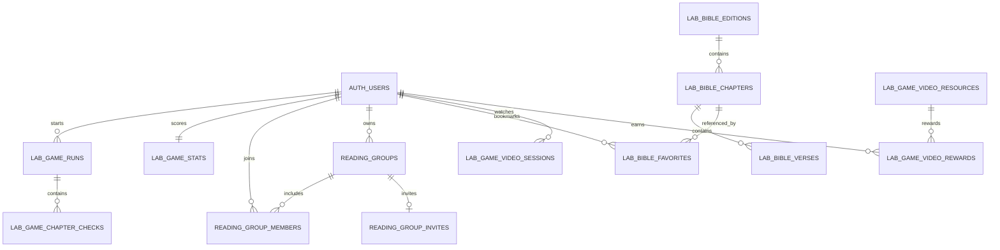

# LABGAME — Dicionário de dados e linhagem do banco

**Versão:** 1.0 · **Data:** 2026-10-12 · **Fonte:** introspecção read-only do Supabase LABGAME (`azejfxvaamgkmfmwdzjn`), schema `public`. **Não inclui CRM**. Colunas, PK e constraints refletem o banco consultado, não apenas migrations locais.

**Status:** 15 tabelas públicas, todas com RLS ativa. Valores de linhas são somente contagens aproximadas retornadas pela ferramenta; não representam garantia de consistência ou usuários atuais. Nenhuma informação pessoal foi consultada para montar este dicionário.

## Relacionamentos principais

## Tabelas, colunas, PK e responsabilidade

### `public.reading_completions`

Registro legado de leitura por ano, fora da pontuação autoritativa LABGAME; acesso individual com RLS.

**PK:** `id` · **RLS:** habilitada · **Linhas na amostra:** 0.

**Colunas:** `id` (uuid); `user_id` (uuid); `reading_year` (integer); `chapter_id` (text); `completed_at` (timestamp with time zone).

**FKs originárias:** `user_id` → `auth.users(id)`.

### `public.reading_groups`

GC: nome, líder e adesão à liga; acesso para membros/líderes.

**PK:** `id` · **RLS:** habilitada · **Linhas na amostra:** 0.

**Colunas:** `id` (uuid); `name` (text); `owner_id` (uuid); `created_at` (timestamp with time zone); `competition_opt_in` (boolean).

**FKs originárias:** `owner_id` → `auth.users(id)`.

### `public.reading_group_members`

Participação e papel dentro do GC; autorização server-side.

**PK:** `group_id`, `user_id` · **RLS:** habilitada · **Linhas na amostra:** 0.

**Colunas:** `group_id` (uuid); `user_id` (uuid); `role` (text).

**FKs originárias:** `group_id` → `public.reading_groups(id)`; `user_id` → `auth.users(id)`.

### `public.reading_group_invites`

Convites únicos dos GCs, nunca divulgar token em logs públicos.

**PK:** `group_id` · **RLS:** habilitada · **Linhas na amostra:** 0.

**Colunas:** `group_id` (uuid); `invite_token` (uuid); `created_at` (timestamp with time zone).

**FKs originárias:** `group_id` → `public.reading_groups(id)`.

### `public.lab_game_plan_chapters`

Plano competitivo versão 1, 365 etapas e 1.189 capítulos; sem política RLS de acesso direto — somente RPC privilegiada.

**PK:** `version`, `day_number`, `slot` · **RLS:** habilitada · **Linhas na amostra:** 1189.

**Colunas:** `version` (smallint); `day_number` (smallint); `slot` (smallint); `chapter_id` (text).

### `public.lab_game_runs`

Tentativas do leitor, início, estado e sequência corrente. Estado do jogo autoritativo.

**PK:** `id` · **RLS:** habilitada · **Linhas na amostra:** 0.

**Colunas:** `id` (uuid); `user_id` (uuid); `started_on` (date); `status` (text); `completed_days` (smallint); `finished_on` (date); `created_at` (timestamp with time zone).

**FKs originárias:** `user_id` → `auth.users(id)`.

### `public.lab_game_chapter_checks`

Confirmações válidas por etapa e por tentativa; base para XP de capítulo.

**PK:** `run_id`, `day_number`, `chapter_id` · **RLS:** habilitada · **Linhas na amostra:** 0.

**Colunas:** `run_id` (uuid); `day_number` (smallint); `chapter_id` (text); `read_on` (date); `confirmed_at` (timestamp with time zone).

**FKs originárias:** `run_id` → `public.lab_game_runs(id)`.

### `public.lab_game_stats`

XP total, recorde, participação voluntária em ranking, nome público.

**PK:** `user_id` · **RLS:** habilitada · **Linhas na amostra:** 0.

**Colunas:** `user_id` (uuid); `best_days` (smallint); `total_xp` (integer); `total_completed_days` (integer); `display_name` (text); `leaderboard_opt_in` (boolean); `updated_at` (timestamp with time zone).

**FKs originárias:** `user_id` → `auth.users(id)`.

### `public.lab_bible_editions`

Metadados de edição/licença e fonte.

**PK:** `code` · **RLS:** habilitada · **Linhas na amostra:** 1.

**Colunas:** `code` (text); `title` (text); `language_code` (text); `attribution` (text); `source_url` (text); `license_label` (text); `created_at` (timestamp with time zone).

### `public.lab_bible_chapters`

Bíblia Almeida 1911 em JSONB por capítulo, leitura pública, escrita administrativa.

**PK:** `edition`, `chapter_id` · **RLS:** habilitada · **Linhas na amostra:** 1189.

**Colunas:** `edition` (text); `chapter_id` (text); `book_name` (text); `chapter_number` (smallint); `verses` (jsonb).

**FKs originárias:** `edition` → `public.lab_bible_editions(code)`.

### `public.lab_game_video_resources`

Índice oficial de panoramas BibleProject, bônus fixo por vídeo único.

**PK:** `video_key` · **RLS:** habilitada · **Linhas na amostra:** 71.

**Colunas:** `video_key` (text); `source_url` (text); `xp` (smallint).

### `public.lab_game_video_sessions`

Início registrado de visualização por usuário; não prova reprodução completa.

**PK:** `user_id`, `video_key` · **RLS:** habilitada · **Linhas na amostra:** 0.

**Colunas:** `user_id` (uuid); `video_key` (text); `started_at` (timestamp with time zone).

**FKs originárias:** `user_id` → `auth.users(id)`; `video_key` → `public.lab_game_video_resources(video_key)`.

### `public.lab_game_video_rewards`

XP extra único por usuário/recurso, independente do XP de leitura.

**PK:** `user_id`, `video_key` · **RLS:** habilitada · **Linhas na amostra:** 0.

**Colunas:** `user_id` (uuid); `video_key` (text); `confirmed_at` (timestamp with time zone); `awarded_xp` (smallint).

**FKs originárias:** `user_id` → `auth.users(id)`; `video_key` → `public.lab_game_video_resources(video_key)`.

### `public.lab_bible_favorites`

Capítulos favoritados individualmente, RLS por identidade.

**PK:** `user_id`, `edition`, `chapter_id` · **RLS:** habilitada · **Linhas na amostra:** 0.

**Colunas:** `user_id` (uuid); `edition` (text); `chapter_id` (text); `created_at` (timestamp with time zone).

**FKs originárias:** `user_id` → `auth.users(id)`; `edition,chapter_id` → `public.lab_bible_chapters(edition,chapter_id)`; `edition` → `public.lab_bible_editions(code)`.

### `public.lab_bible_verses`

31.101 versículos de pesquisa, texto público com atribuição.

**PK:** `edition`, `chapter_id`, `verse_number` · **RLS:** habilitada · **Linhas na amostra:** 31101.

**Colunas:** `edition` (text); `chapter_id` (text); `verse_number` (smallint); `verse_text` (text).

**FKs originárias:** `edition,chapter_id` → `public.lab_bible_chapters(edition,chapter_id)`.

## Autorizações e isolamento

- `anon`: leitura exclusivamente pública da Bíblia, seus versículos e índice de panoramas; consultas públicas de pesquisa. **Não deve ter TRUNCATE/TRIGGER/REFERENCES** nem execução de triggers internos.
- `authenticated`: acesso aos próprios favoritos, runs/scorecard e memberships conforme RLS. Leitura/soma de XP exclusivamente por funções validadas e transacionais.
- `service_role/postgres`: responsabilidades administrativas e de migração; credenciais somente backend e ambiente controlado.
- `lab_game_plan_chapters`: RLS sem policy de leitura intencional; plano congelado disponível por funções do servidor. Nunca abrir INSERT/UPDATE ao cliente.
- `reading_completions`: esquema legado separado da trilha competitiva; não considerar como fonte de pontuação LABGAME.
- `SECURITY DEFINER`: as funções `lab_game_*` requerem checagem `auth.uid()`, grupo e autorização. Trigger helpers terão EXECUTE público revogado após a migração de segurança.

## Operação / migração

- **Fonte reprodutível:** `lab-app/supabase/migrations/`. Existem 12 migrações aplicadas originalmente, com timestamps de execução no Supabase diferentes dos nomes de arquivos de origem. Consultar `list_migrations` antes de aplicar as próximas.
- **Nova migração de segurança:** `202610120001_lab_privileges_hardening.sql` — preparada, ainda **NÃO APLICADA** no momento desta atualização.
- **Aceite ACL pós-migração:** `lab-app/scripts/sql/security-post-migration-check.sql` deve retornar zero linhas.
- **Staging/backup/restore:** PENDENTE, não executar DDL em produção sem aprovação específica.
- **Privacidade e retenção:** definir base legal, tempo de retenção, exportação/remoção e tratamento de menores, especialmente em GCs e rankings.
- **Observabilidade:** `lab_game_scorecard` retorna `balanced` para reconciliação; índices faltantes e custo de consultas de liga requerem medição.

## Itens de evolução arquitetural

Não há tabelas de IA, embeddings, corpus, estudos gerados, mapas mentais, flashcards, logs de revisão editorial ou cobrança/pacotes atualmente. Projetá-las após schema versionado e modelo de autorização; nunca atribuir XP ao resultado probabilístico da IA.

Ver também `docs/ARCHITECTURE.md`, `docs/SECURITY-LIVE-AUDIT-2026-10-12.md` e `docs/AI-ARCHITECTURE-AND-GOVERNANCE.md`.
